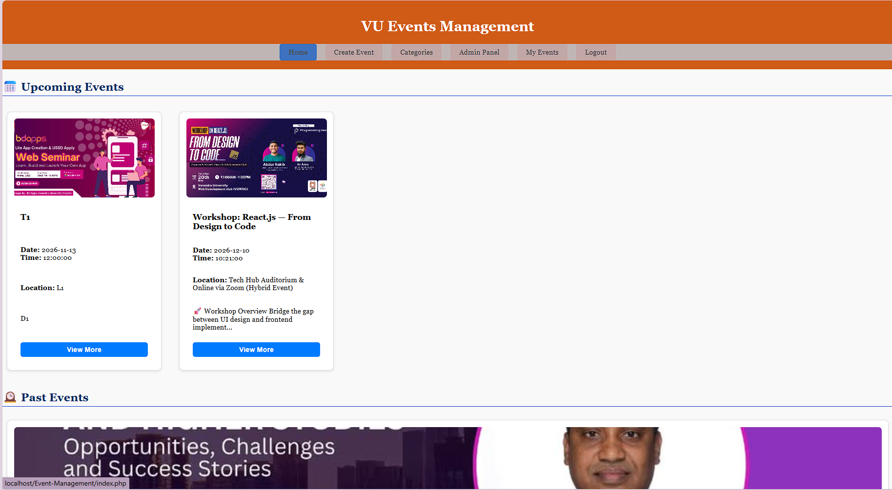
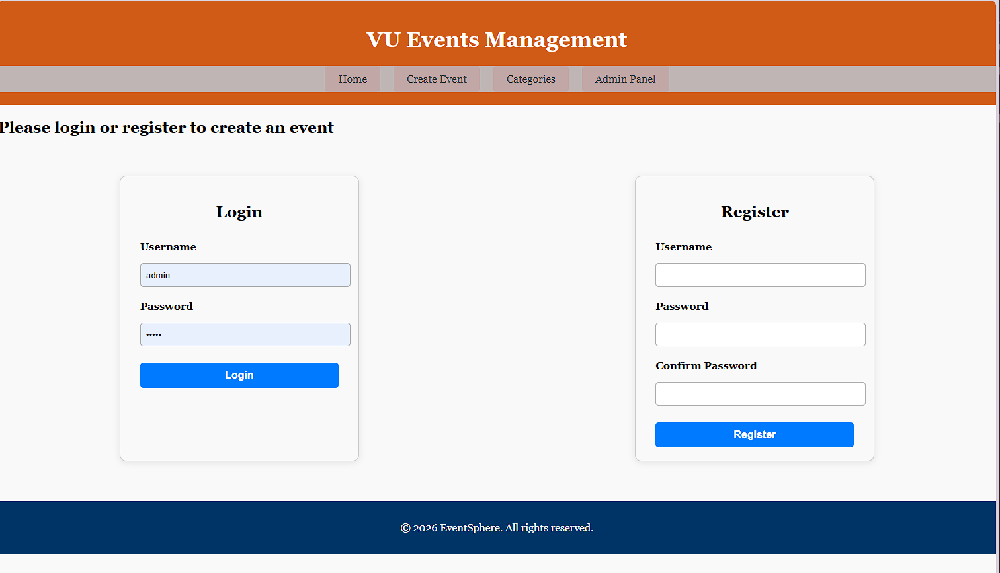
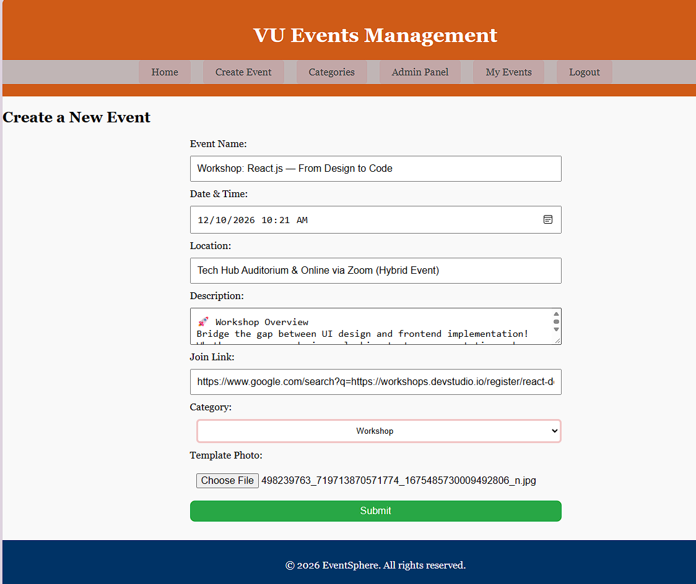
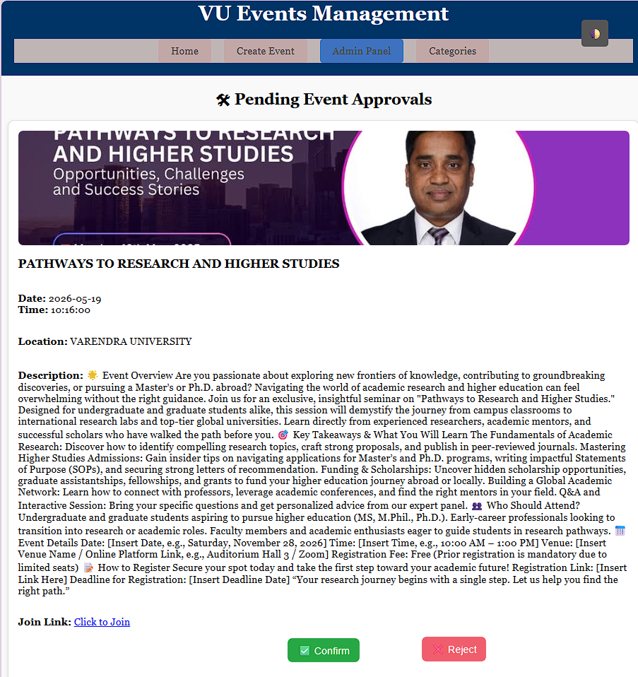
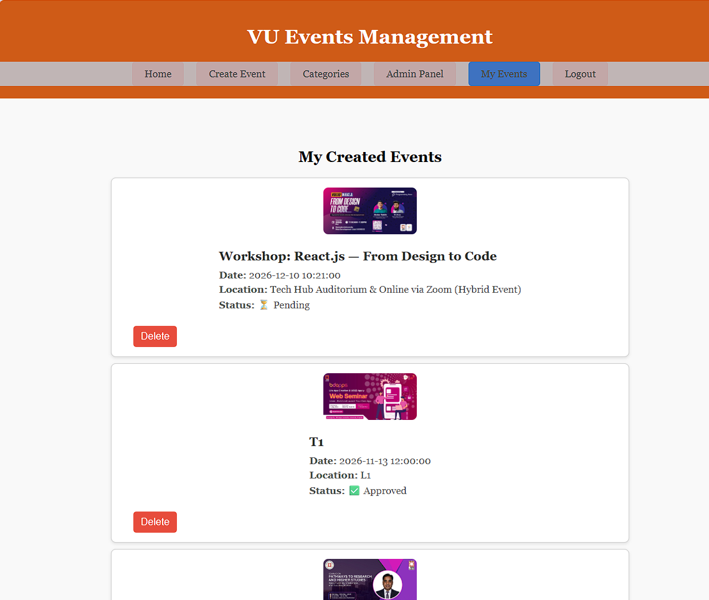

# VU Events Management (EventSphere)

A web app for publishing and discovering events, built with PHP and MySQL. Registered users submit events with a cover photo, and an admin approves or rejects each one before it appears publicly.

Built as my undergraduate project at Varendra University.

## Features

**Visitors**
- Browse approved events, split into **Upcoming** and **Past**
- Open a "View More" popup with the full details and a join link
- Click any event photo to open a full-screen viewer with zoom (mouse wheel), drag, and previous/next arrows
- Filter events by category

**Registered users**
- Register and log in with a username and password
- Create an event: name, date and time, location, description, join link, category, and cover photo
- **My Events** page showing each event's status (Pending or Approved), with the option to delete it

**Admin**
- Separate admin login
- Review pending events and **Confirm** or **Reject** each one
- Add new event categories

Screenshots
### Home page



### Log in



### Create an event



### Admin approval



### My Events




## Tech Stack

- **Backend:** PHP 8+ (procedural, `mysqli`)
- **Database:** MySQL / MariaDB
- **Frontend:** HTML, CSS, vanilla JavaScript
- **Auth:** PHP sessions
- **Uploads:** event photos are stored in the `uploads/` folder

## Getting Started

### Prerequisites

- PHP 8.0 or newer, with the `mysqli` and `mbstring` extensions enabled
- MySQL or MariaDB
- A local server stack such as [XAMPP](https://www.apachefriends.org/), WAMP, or Laragon (recommended), or PHP's built-in server

### Installation

1. **Get the code**
   ```bash
   git clone https://github.com/shihabpk99/Event-Management-.git
   ```
   Or download the ZIP and extract it.

2. **Place it in your server's web root**, for example `C:\xampp\htdocs\` for XAMPP.

3. **Create the database.** Start MySQL, open phpMyAdmin (or the MySQL shell), and create a database named `events_management`.

4. **Import the schema.** Run the SQL in [`query.txt`](query.txt) against that database. It creates the `users`, `categories`, and `events` tables and adds four default categories (Conference, Workshop, Webinar, Meetup).

5. **Check the database settings** in [`db.php`](db.php). The defaults suit a fresh XAMPP install:
   ```php
   $servername = "localhost";
   $username   = "root";
   $password   = "";
   $dbname     = "events_management";
   ```

6. **Make sure `uploads/` is writable** by the web server.

7. **Start Apache and MySQL**, then open:
   ```
   http://localhost/Event-Management-/
   ```
   (Use whatever folder name you placed the project in.)

**Without XAMPP:** with MySQL running and the database imported, you can start PHP's built-in server from the project folder:
```bash
php -S localhost:8000
```
Then open `http://localhost:8000`.

## Usage

1. Go to **Create Event**, register an account, and submit an event. It is saved as *Pending*.
2. Open **Admin Panel** (`admin.php`) and log in. The admin username and password are set at the top of `admin.php`; change them before using this anywhere beyond your own machine.
3. On the approval page, click **Confirm** to publish the event or **Reject** to delete it.
4. Approved events appear on the home page, under Upcoming or Past depending on their date.
5. Admins can add categories at `categories.php`.

## Database Schema

| Table | Columns |
|---|---|
| `users` | `id`, `username` (unique), `password` |
| `categories` | `id`, `name` |
| `events` | `id`, `event_name`, `event_date`, `event_time`, `location`, `description`, `join_link`, `photo`, `is_approved`, `category_id` (FK), `user_id` (FK) |

## Project Structure

```
.
├── index.php             # Home: upcoming and past approved events
├── categorie_list.php    # Events filtered by category
├── categories.php        # Admin: add and list categories
├── create_event.php      # Event submission form (login required)
├── user_page.php         # "My Events": status and delete
├── auth.php              # Login and register forms
├── auth_process.php      # Handles login and registration
├── logout.php            # Ends the session
├── admin.php             # Admin login
├── admin_approval.php    # Pending events list
├── approve_event.php     # Marks an event as approved
├── reject_event.php      # Deletes a rejected event
├── header.php            # Shared header and navigation
├── footer.php            # Shared footer and image viewer script
├── db.php                # Database connection
├── query.txt             # SQL schema and default categories
├── styles.css            # Styles
└── uploads/              # Uploaded event photos
```

## Known Limitations and Future Improvements

This is a student project, so there is room to harden it:

- Use prepared statements instead of building SQL by string interpolation
- Hash passwords with `password_hash()` / `password_verify()` instead of storing them as plain text
- Move admin credentials out of the source code, and check the admin session in `approve_event.php`, `reject_event.php`, and `categories.php`
- Validate uploaded files (type and size) and give them unique names
- Escape all output consistently with `htmlspecialchars()`
- `admin_approval.php` redirects logged-out visitors to `admin_login.php`, which doesn't exist; it should point to `admin.php`

## Author

**Md. Shihab PK**
GitHub: [@shihabpk99](https://github.com/shihabpk99)
